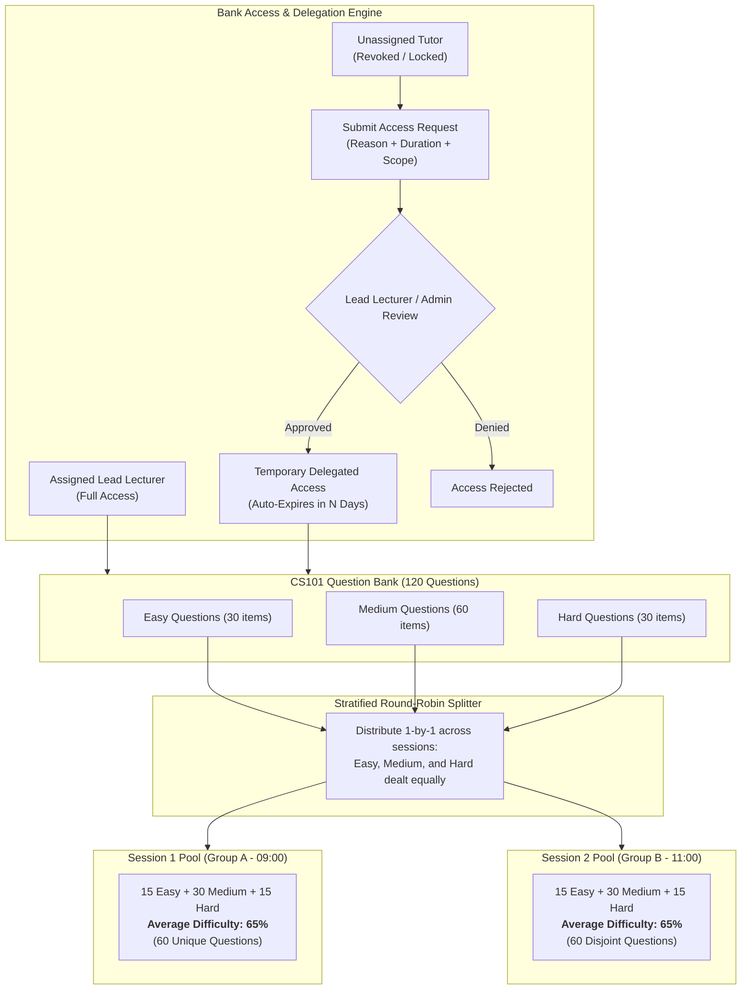

# Implementation Plan: Dynamic Question Bank, Course Lifecycle & Multi-Session Cohort Engine

## 1. Executive Summary & Core Pillars

This plan provides the architecture and implementation roadmap for:
1. **Institutional Course Registry & Secure Tutor Transitions**:
   - Courses and Question Banks belong to the institution, preserving questions across academic terms.
   - **Active Assignment Gating**: Unassigned tutors cannot view or export a course's questions by default.
   - **Controlled Access Request Workflow**: Unassigned tutors (e.g. co-teachers, external examiners, or past tutors) can submit a formal **Access Request** with justification, which must be approved by the Lead Lecturer or Department Head.
   - **Retire & Refresh Policy**: Incoming lecturers can archive previous exam questions to eliminate leak risks from past terms.
2. **Difficulty-Stratified Round-Robin Session Splitting**:
   - Replaces naive sequential slicing ($1–50$ vs $51–100$) with a **psychometric round-robin distribution** that guarantees Session 1 (Group A) and Session 2 (Group B) have **identically balanced difficulty curves and equal pass-rate expectations with zero shared questions**.
3. **Zero-Burden Question Entry**: Lecturers only input question text, options, and correct answers. `Topic` defaults to `"General"` and `Difficulty` defaults to `"Medium"`.
4. **Empirical Difficulty Auto-Calibration (No AI)**: Difficulty ratings are mathematically updated based on real student pass rates ($\ge 80\%$ Easy, $40\%-79\%$ Medium, $<40\%$ Hard).
5. **Dynamic Per-Student Draw-on-Demand**: Every student receives an independent randomized draw of $N$ questions upon clicking "Start Exam", frozen in `quiz_attempt_questions` for auditability and reproducible grading.



---

## 2. Detailed Technical Solutions to Specific Operational Risks

### 2.1 Preventing Leaks When Tutors Change & The Access Request Protocol

**The Risk**: 
- If Mr. Smith is unassigned from `CS101`, he shouldn't browse questions freely.
- **However**, what if Mr. Smith legitimately needs access (e.g. co-teaching, moderating the exam, curriculum review, or borrowing foundational questions for a prerequisite course)?

#### The Solution: Controlled Access Request & Delegation Workflow

1. **Default State**:
   - Only the **Currently Assigned Lecturer** and **Super Admins** have immediate read/write access.
   - For all other lecturers, `CS101` Question Bank displays with a lock icon: 🔒 *"Restricted — You are not currently assigned to this course."*

2. **The "Request Bank Access" Workflow**:
   - The unassigned lecturer clicks **"Request Access to Bank"**.
   - A modal requires them to provide:
     - **Academic Justification**: (e.g. *"Internal moderation for Mid-Semester Exam"*, *"Co-teaching Lab Sections"*).
     - **Requested Permission Level**:
       - `read_only` (Viewer / Examiner): Can browse questions to select for exams or moderate, but cannot modify.
       - `contributor` (Editor): Can submit new questions into the bank.
     - **Access Window / Duration**: (e.g. *3 Days, 7 Days, 30 Days, or Current Term*).
   
3. **Approval Routing**:
   - The pending request appears in two places:
     - In the **Lead Lecturer's** notification center & course dashboard.
     - In the **Super Admin / Department Head's** moderation dashboard.
   - Either authority can click **"Approve"** (with optional review notes) or **"Reject"**.

4. **Automatic Expiry & Immutable Audit Trail**:
   - Once approved, the lecturer gains temporary access until `expires_at`.
   - The system automatically revokes access the minute `expires_at` is reached.
   - Every question view, exam creation, or CSV download during this window is permanently logged:
     `[AUDIT] Dr. Smith accessed CS101 Bank under Temporary Delegation #REQ-204 (Approved by Dr. Johnson). IP: 192.168.1.50`

5. **Incoming Lecturer "Retire & Refresh" Protocol**:
   - When a new lecturer takes over `CS101`, the system provides a 1-click **"Retire Previous Term Pool"** action:
     - Sets `status = 'retired'` on questions previously used in live examinations.
     - Retired questions can be converted into practice questions for students, while new live exam questions are authored, guaranteeing 0% leak risk from past terms.

---

### 2.2 Solving Session Difficulty Imbalance (Stratified Round-Robin)

**The Risk**: In a naive sequential split (e.g. Session 1 gets questions $1–50$, Session 2 gets questions $51–100$), Session 1 might get all easy questions while Session 2 gets all hard questions, causing unfair failure rates in Group B.

#### Technical Solution: **Difficulty-Stratified Round-Robin Allocation**

Rather than slicing the array in sequential chunks, the allocation engine balances both sessions psychometrically:

```typescript
export interface BalancedSessionPools {
  session1Pool: QuestionBankItem[];
  session2Pool: QuestionBankItem[];
}

export function generateBalancedSessionPools(
  bankQuestions: QuestionBankItem[]
): BalancedSessionPools {
  // 1. Group questions by difficulty (based on empirical pass rate or tag)
  const easy = bankQuestions.filter(q => q.difficulty === 'easy');
  const medium = bankQuestions.filter(q => q.difficulty === 'medium');
  const hard = bankQuestions.filter(q => q.difficulty === 'hard');

  const session1Pool: QuestionBankItem[] = [];
  const session2Pool: QuestionBankItem[] = [];

  // 2. Round-Robin distribution function for each stratum
  const distributeStratum = (stratum: QuestionBankItem[]) => {
    // Shuffle within stratum first to avoid alphabetical bias
    const shuffled = shuffleArray(stratum);
    shuffled.forEach((q, idx) => {
      if (idx % 2 === 0) {
        session1Pool.push(q);
      } else {
        session2Pool.push(q);
      }
    });
  };

  // 3. Dealt evenly like cards: Easy, Medium, Hard
  distributeStratum(easy);
  distributeStratum(medium);
  distributeStratum(hard);

  return { session1Pool, session2Pool };
}
```

#### Results of this Algorithm:
- **Zero Question Overlap**: No question in Session 1 appears in Session 2 (complete leak protection).
- **Exact Proportional Difficulty**:
  - If the bank has 30 Easy, 60 Medium, and 30 Hard questions:
    - **Session 1** gets: **15 Easy, 30 Medium, 15 Hard** (60 total questions).
    - **Session 2** gets: **15 Easy, 30 Medium, 15 Hard** (60 total questions).
  - Both sessions have the exact same expected mean score and psychometric validity.

---

### 2.3 Per-Student Dynamic Draw-on-Demand (Individual Randomization)

- Within each session pool (e.g., Session 1's 60 questions):
  - When **Alice** clicks *"Start Exam"*, the engine samples **25 questions** dynamically and freezes them into `quiz_attempt_questions`.
  - When **Bob** clicks *"Start Exam"*, the engine samples a different set of **25 questions** for Bob.
  - Option orders ($A, B, C, D$) are independently shuffled.
  - If a student's laptop battery dies or the browser closes, their in-progress attempt reloads the **exact same frozen 25 questions**.
  - On submission, each student's score is computed against their assigned questions.

---

### 2.4 Empirical Difficulty Auto-Calibration (Pure Statistics, No AI)

- When adding questions, the lecturer only provides the question text, choices, and answer.
- The system automatically monitors student results:
  $$\text{Question Pass Rate} = \left(\frac{\text{Times Answered Correctly}}{\text{Total Times Answered Across All Exams}}\right) \times 100$$
- Calibration Thresholds:
  - **$\ge 80\%$ Correct**: Automatically tagged **Easy**
  - **$40\% - 79\%$ Correct**: Automatically tagged **Medium**
  - **$< 40\%$ Correct**: Automatically tagged **Hard**
  - **$< 5$ attempts**: Displayed as **"Calibrating"**
- The Question Bank's difficulty ratings automatically become more accurate after every exam sitting without any subjective guessing or AI overhead.

---

## 3. Database Schema

### 3.1 Course Catalog (`courses`)
```sql
CREATE TABLE IF NOT EXISTS courses (
  id uuid PRIMARY KEY DEFAULT uuid_generate_v4(),
  code text NOT NULL,                    -- e.g. 'CS101'
  title text NOT NULL,                   -- e.g. 'Introduction to Programming'
  department text DEFAULT '',
  assigned_lecturer_id uuid REFERENCES profiles(id) ON DELETE SET NULL,
  created_at timestamptz DEFAULT now(),
  updated_at timestamptz DEFAULT now(),
  UNIQUE(code)
);
CREATE INDEX IF NOT EXISTS idx_courses_lecturer ON courses(assigned_lecturer_id);
```

### 3.2 Master Question Bank (`question_bank`)
```sql
CREATE TABLE IF NOT EXISTS question_bank (
  id uuid PRIMARY KEY DEFAULT uuid_generate_v4(),
  course_id uuid NOT NULL REFERENCES courses(id) ON DELETE CASCADE,
  topic text NOT NULL DEFAULT 'General',
  difficulty text NOT NULL DEFAULT 'medium' CHECK (difficulty IN ('easy', 'medium', 'hard')),
  status text NOT NULL DEFAULT 'active' CHECK (status IN ('active', 'retired', 'draft')),
  question_text text NOT NULL,
  question_type text NOT NULL DEFAULT 'mcq' CHECK (question_type IN ('mcq', 'true_false', 'essay')),
  options text,                          -- JSON array of choices
  correct_answer text,
  marks integer NOT NULL DEFAULT 1,
  times_answered integer DEFAULT 0,
  times_correct integer DEFAULT 0,
  empirical_pass_rate numeric(5,2) DEFAULT NULL,
  created_at timestamptz DEFAULT now(),
  updated_at timestamptz DEFAULT now()
);
CREATE INDEX IF NOT EXISTS idx_qb_course ON question_bank(course_id);
CREATE INDEX IF NOT EXISTS idx_qb_status ON question_bank(status);
```

### 3.3 Question Bank Access Delegation Requests (`question_bank_access_requests`)
```sql
CREATE TABLE IF NOT EXISTS question_bank_access_requests (
  id uuid PRIMARY KEY DEFAULT uuid_generate_v4(),
  course_id uuid NOT NULL REFERENCES courses(id) ON DELETE CASCADE,
  requester_id uuid NOT NULL REFERENCES profiles(id) ON DELETE CASCADE,
  reason text NOT NULL,
  access_level text NOT NULL DEFAULT 'read_only' CHECK (access_level IN ('read_only', 'contributor')),
  duration_days integer NOT NULL DEFAULT 7,
  status text NOT NULL DEFAULT 'pending' CHECK (status IN ('pending', 'approved', 'rejected', 'expired')),
  reviewed_by uuid REFERENCES profiles(id),
  reviewed_at timestamptz,
  expires_at timestamptz,
  review_notes text,
  created_at timestamptz DEFAULT now()
);
CREATE INDEX IF NOT EXISTS idx_qbar_course ON question_bank_access_requests(course_id);
CREATE INDEX IF NOT EXISTS idx_qbar_requester ON question_bank_access_requests(requester_id);
```

### 3.4 Quiz Updates & Exam Sessions (`quiz_sessions`)
```sql
ALTER TABLE quizzes ADD COLUMN IF NOT EXISTS course_id uuid REFERENCES courses(id);
ALTER TABLE quizzes ADD COLUMN IF NOT EXISTS is_dynamic_draw boolean DEFAULT false;
ALTER TABLE quizzes ADD COLUMN IF NOT EXISTS draw_question_count integer DEFAULT 0;

CREATE TABLE IF NOT EXISTS quiz_sessions (
  id uuid PRIMARY KEY DEFAULT uuid_generate_v4(),
  quiz_id uuid NOT NULL REFERENCES quizzes(id) ON DELETE CASCADE,
  session_name text NOT NULL,            -- e.g. 'Group A - Morning Shift'
  start_time timestamptz NOT NULL,
  end_time timestamptz NOT NULL,
  access_pin text,                       -- 4-digit proctor code
  session_pool_index integer NOT NULL DEFAULT 1, -- Pool slot (1, 2, etc.)
  created_at timestamptz DEFAULT now()
);
```

### 3.5 Student Session Allocations (`quiz_session_students`)
```sql
CREATE TABLE IF NOT EXISTS quiz_session_students (
  id uuid PRIMARY KEY DEFAULT uuid_generate_v4(),
  session_id uuid NOT NULL REFERENCES quiz_sessions(id) ON DELETE CASCADE,
  student_id uuid NOT NULL REFERENCES profiles(id) ON DELETE CASCADE,
  created_at timestamptz DEFAULT now(),
  UNIQUE(session_id, student_id)
);
CREATE INDEX IF NOT EXISTS idx_session_student ON quiz_session_students(student_id);
```

### 3.6 Frozen Question Attempt Table (`quiz_attempt_questions`)
```sql
CREATE TABLE IF NOT EXISTS quiz_attempt_questions (
  id uuid PRIMARY KEY DEFAULT uuid_generate_v4(),
  attempt_id uuid NOT NULL REFERENCES quiz_attempts(id) ON DELETE CASCADE,
  question_bank_id uuid REFERENCES question_bank(id) ON DELETE CASCADE,
  question_id uuid REFERENCES questions(id) ON DELETE CASCADE,
  order_index integer NOT NULL,
  created_at timestamptz DEFAULT now(),
  CONSTRAINT chk_question_ref CHECK (
    (question_bank_id IS NOT NULL AND question_id IS NULL) OR
    (question_bank_id IS NULL AND question_id IS NOT NULL)
  ),
  UNIQUE(attempt_id, order_index)
);
CREATE INDEX IF NOT EXISTS idx_attempt_questions ON quiz_attempt_questions(attempt_id);
```

---

## 4. Execution Roadmap

| Milestone | Deliverables | Key Safeguards |
| :--- | :--- | :--- |
| **Phase 1** | **Course Registry, Question Bank & Access Delegation** | • DDL execution for `courses`, `question_bank`, and `question_bank_access_requests`.<br/>• Gated API queries: Lecturers only see courses they actively teach or have active approved requests for.<br/>• "Request Bank Access" modal for unassigned tutors.<br/>• Question Bank page with CSV bulk import/export & audit watermarking. |
| **Phase 2** | **Dynamic Draw & Stratified Round-Robin Engine** | • Add "Dynamic Draw from Bank" mode in `CreateQuiz.tsx`.<br/>• Implement `generateBalancedSessionPools` for psychometrically equal sessions.<br/>• Build per-student dynamic question sampler in `TakeQuiz.tsx` with frozen attempts in `quiz_attempt_questions`. |
| **Phase 3** | **Multi-Session Cohort Scheduler** | • Build session manager in Quiz details.<br/>• Split student rosters into Group A, Group B, Group C by index number or 50/50 split.<br/>• Set schedule windows and proctor PINs. |
| **Phase 4** | **Gatekeeper & Empirical Calibration Engine** | • Gatekeep exam entry in `TakeQuiz.tsx` by assigned session time and PIN.<br/>• On attempt submission, auto-increment question answer counts and recalculate `empirical_pass_rate`. |
| **Phase 5** | **Session-Aware Broadsheets** | • Enable broadsheet exports filtered by Session / Group.<br/>• Display comparative group metrics (Group A Mean vs Group B Mean) to verify test fairness. |
