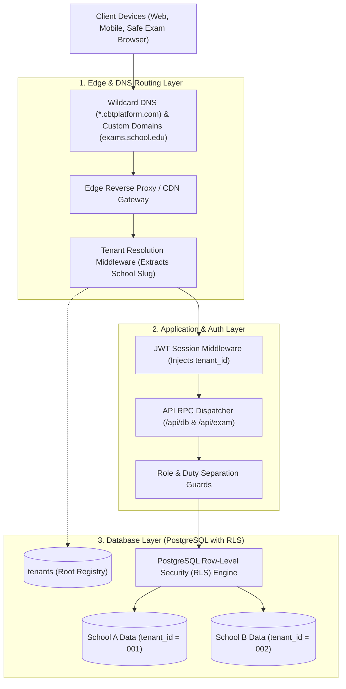
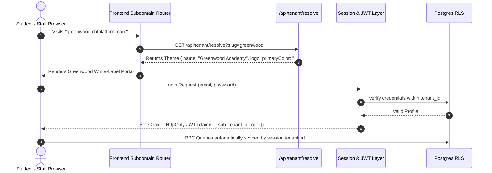
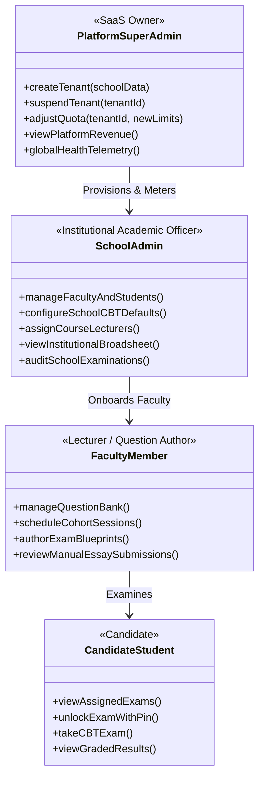
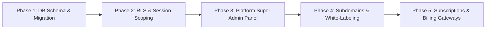

# Multi-Tenant B2B SaaS Architecture & Transformation Specification

This architectural specification details the strategic blueprint for converting the single-institution Computer-Based Testing (CBT) and examination system into a scalable, multi-tenant B2B Software-as-a-Service (SaaS) platform capable of serving hundreds of independent schools, colleges, and training institutes.

---

## 1. High-Level Multi-Tenant Architecture



---

## 2. Multi-Tenancy Data Isolation Strategy

### 2.1 The Recommended Model: Shared Database with Row-Level Security (RLS)
For modern serverless PostgreSQL (such as Neon), **Shared Database with PostgreSQL Row-Level Security (RLS)** provides the optimal balance of:
- **Cost Efficiency:** A single serverless database pool auto-scales with compute demand.
- **Maintenance:** Schema migrations run once across the database rather than hundreds of individual databases.
- **Security:** Hardware/engine-enforced data isolation at the SQL query level prevents cross-tenant data leaks.

### 2.2 Root Tenant Schema (`tenants`)
```sql
CREATE TABLE tenants (
    id UUID PRIMARY KEY DEFAULT gen_random_uuid(),
    name VARCHAR(255) NOT NULL,
    slug VARCHAR(63) NOT NULL UNIQUE,          -- Subdomain: "greenwood", "oxford-cbt"
    custom_domain VARCHAR(255) UNIQUE,         -- Optional CNAME: "exams.greenwood.edu"
    status VARCHAR(50) DEFAULT 'active',       -- "active", "suspended", "past_due"
    
    -- Subscription & Entitlements
    plan_tier VARCHAR(50) DEFAULT 'starter',   -- "starter", "pro", "enterprise"
    max_active_students INT DEFAULT 500,
    max_concurrent_exams INT DEFAULT 2,
    enable_seb_lockdown BOOLEAN DEFAULT TRUE,
    enable_webcam_proctoring BOOLEAN DEFAULT FALSE,
    enable_custom_domain BOOLEAN DEFAULT FALSE,
    
    -- Branding & White-Labeling
    logo_url TEXT,
    brand_primary_color VARCHAR(10) DEFAULT '#4F46E5',
    portal_title VARCHAR(255),
    support_email VARCHAR(255),
    
    created_at TIMESTAMPTZ DEFAULT NOW(),
    updated_at TIMESTAMPTZ DEFAULT NOW()
);

CREATE INDEX idx_tenants_slug ON tenants(slug);
CREATE INDEX idx_tenants_custom_domain ON tenants(custom_domain);
```

### 2.3 Scoping Core Entity Tables
Every functional table in the system is updated to include an indexed `tenant_id` foreign key:
- `profiles` (`tenant_id`, `role`, `email`, `index_number`, ...)
- `courses` (`tenant_id`, `code`, `title`, ...)
- `quizzes` (`tenant_id`, `course_id`, `lecturer_id`, ...)
- `questions` & `question_bank` (`tenant_id`, ...)
- `quiz_attempts` & `student_answers` (`tenant_id`, ...)
- `quiz_sessions` (`tenant_id`, `quiz_id`, ...)
- `system_settings` (`tenant_id`, `setting_key`, ...)
- `audit_logs` (`tenant_id`, `user_id`, ...)

> [!IMPORTANT]
> **Unique Indexes Must Become Tenant-Scoped:**
> Email and student index numbers are unique *within a school*, but students or staff may legitimately exist in multiple distinct schools:
> ```sql
> -- Old single-tenant index:
> -- CREATE UNIQUE INDEX profiles_email_key ON profiles (email);
> 
> -- New multi-tenant compound indexes:
> CREATE UNIQUE INDEX idx_profiles_tenant_email ON profiles(tenant_id, LOWER(email));
> CREATE UNIQUE INDEX idx_profiles_tenant_index ON profiles(tenant_id, LOWER(index_number)) WHERE index_number IS NOT NULL;
> CREATE UNIQUE INDEX idx_courses_tenant_code ON courses(tenant_id, UPPER(code));
> ```

---

## 3. Tenant Identification & Subdomain Routing



### 3.1 Subdomain Resolution
The client identifies its school context by inspecting the hostname:
```typescript
export function extractTenantSlug(): string | null {
  const host = window.location.hostname; // e.g. "greenwood.cbtapp.com"
  
  // Local development override support: ?tenant=greenwood or localhost:5173
  const urlParams = new URLSearchParams(window.location.search);
  if (urlParams.get('tenant')) {
    return urlParams.get('tenant');
  }

  const parts = host.split('.');
  if (parts.length > 2 && !['www', 'app', 'staging'].includes(parts[0])) {
    return parts[0].toLowerCase();
  }
  return null;
}
```

---

## 4. Two-Tier Role & Administrative Hierarchy

To operate a multi-tenant SaaS, administrative responsibilities are split into **Platform Super Admin** and **Tenant (School) Admin**:



### 4.1 Role Matrix
1. **`platform_admin`:** The SaaS operator. Has cross-tenant visibility for provisioning, billing, feature flags, and infrastructure maintenance.
2. **`school_admin`:** The School Principal, ICT Director, or Registrar. Has full authority over their school's users, exams, and settings, but zero visibility into any other school.
3. **`moderator` / `lecturer`:** Academic faculty confined strictly to their school's question banks and courses.
4. **`student`:** Candidate whose enrollment, attempts, and transcripts exist solely within that school.

---

## 5. White-Label Theming & Dynamic Branding

Schools require their portal to feel native to their institution.

### 5.1 Dynamic Theme Provider
```tsx
export interface TenantBranding {
  id: string;
  name: string;
  slug: string;
  logo_url: string | null;
  brand_primary_color: string;
  portal_title: string;
  support_email: string;
}

export function applyTenantTheme(branding: TenantBranding) {
  const root = document.documentElement;
  // Dynamically set CSS variables controlling Tailwind themes
  root.style.setProperty('--color-tenant-primary', branding.brand_primary_color);
  
  if (branding.portal_title) {
    document.title = branding.portal_title;
  }
}
```

---

## 6. Subscription Tiers, Billing & Quota Enforcement

### 6.1 Packaging & Pricing Models

| Tier | Target Institution | Candidate Quota | Core Capabilities |
| :--- | :--- | :---: | :--- |
| **Starter** | Small Tutoring Centers / K-12 Academies | Up to 300 Candidates | Standard MCQ exams, Instant grading, PDF broadsheets |
| **Growth / Pro** | Mid-size Colleges & Secondary Schools | Up to 2,000 Candidates | Safe Exam Browser (SEB) lock, Cohort session timetable, Multi-session anti-leak pooling |
| **Enterprise** | Universities, State Exam Boards, JAMB/WAEC Centers | Unlimited Candidates | Webcam proctoring, Custom domain SSL (`exams.univ.edu`), Dedicated DB branch, Priority SLA |

### 6.2 Server-Side Quota Enforcement Guard
In the API registry ([registry.ts](file:///home/chillop/project/online-quiz-app/api/_lib/registry.ts)), enforce entitlement quotas before resource allocation:
```typescript
export async function assertTenantStudentQuota(tenantId: string): Promise<void> {
  const [tenant] = await sql`SELECT max_active_students, plan_tier FROM tenants WHERE id = ${tenantId}`;
  const [countResult] = await sql`
    SELECT COUNT(*)::int as count 
    FROM profiles 
    WHERE tenant_id = ${tenantId} AND role = 'student'
  `;

  if (countResult.count >= tenant.max_active_students) {
    throw new HttpError(
      402, 
      `Candidate quota exceeded (${countResult.count}/${tenant.max_active_students}). Please upgrade your school subscription tier.`
    );
  }
}
```

---

## 7. Migration & Rollout Roadmap

The transition from single-institution to multi-tenant SaaS is planned across 5 controlled phases:



### Phase 1: Database Migration & Multi-Tenant Schema
1. Create `tenants` table.
2. Add `tenant_id UUID REFERENCES tenants(id)` across all existing tables.
3. Migrate existing data under a default anchor tenant (e.g. `primary-school`).
4. Replace global unique indexes with `(tenant_id, column)` compound indexes.

### Phase 2: Session & Query Scoping
1. Embed `tenant_id` inside JWT claims in [session.ts](file:///home/chillop/project/online-quiz-app/api/_lib/session.ts).
2. Update [registry.ts](file:///home/chillop/project/online-quiz-app/api/_lib/registry.ts) and query handlers to automatically inject `WHERE tenant_id = ...`.
3. Enable PostgreSQL Row-Level Security (RLS) policies as an automated guardrail.

### Phase 3: Platform Super Admin Portal
1. Create dedicated `/platform-admin` routes accessible exclusively to SaaS operators.
2. Tenant onboarding workflow: Create new school, generate admin invite link, assign quotas.
3. Global metrics dashboard: Total active schools, total exams run, candidate concurrency.

### Phase 4: Subdomains & Dynamic Branding
1. Configure Wildcard DNS (`*.cbtplatform.com`) in Vercel / Cloudflare.
2. Build frontend tenant resolver to load school logo and color themes on boot.
3. Provide school admins with a "Branding Settings" tab to upload their emblem and customize titles.

### Phase 5: Billing & Automated Provisioning
1. Integrate Stripe / Paystack webhook handlers for automated termly/annual subscription renewal.
2. Implement automated grace-period notifications for expiring institutional licenses.
3. Self-service trial onboarding with sample courses and demo CBT candidate credentials.

